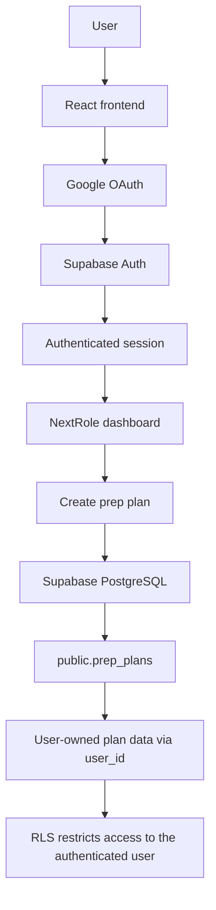

# NextRole

NextRole is a React + Vite frontend for interview preparation and career planning. The current implementation uses Supabase Auth for session-based access and stores interview-prep plans under the authenticated user’s account.

## Tech stack

- React
- JavaScript
- Vite
- Tailwind CSS
- React Router
- Supabase JavaScript client (`@supabase/supabase-js`)

The frontend initializes Supabase with the project environment values:

- `VITE_SUPABASE_URL`
- `VITE_SUPABASE_PUBLISHABLE_KEY`

These values are used in the frontend client setup and must never be replaced with service-role keys. Service-role keys are privileged backend credentials and must not be exposed in browser code or committed to the frontend.

## Current architecture split

The project is currently implemented as a frontend app with Supabase acting as the backend service. There is no separate custom backend in this repository.

### Frontend

- React app for pages, forms, navigation, and UI state
- Routing handled with React Router
- Auth and data flows triggered from UI actions
- Feature files and page logic live in the frontend app under `frontend/src`

### Supabase backend service

- Supabase Auth handles Google login and session creation
- Supabase PostgreSQL stores and retrieves application data
- The `prep_plans` table is the main persistence layer for interview-prep plans
- RLS enforces user ownership and access boundaries at the database level
- The frontend uses the Supabase JavaScript client to interact with auth and PostgreSQL

This is the backend layer for the current implementation. We are using Supabase as the backend service, not a separate Node.js/Express API.

### Important clarification

There is no additional custom backend layer in this repo right now. All application logic that interacts with auth and persistence is currently located in the frontend codebase and uses Supabase APIs directly.

## Current authentication flow

The app currently supports Google sign-in through Supabase Auth. The implemented flow is:

1. The user clicks Continue with Google on the login or signup page.
2. Google authenticates the user through Supabase Auth.
3. Supabase establishes an authenticated session.
4. The user is redirected to the configured NextRole URL.
5. React reads the active session and can access the authenticated user ID and metadata.
6. The header displays the signed-in user’s name or email prefix, initials, and a Sign out button.

This is already working in local testing. The login and signup pages are present, and the signup page currently prioritizes Google sign-in while also keeping a link to `/login`.

Local development commonly runs at:

- `http://localhost:5173`

This matches the default Vite dev server behavior unless the config is changed later.

## Auth implementation notes

The project currently uses Supabase’s auth session flow through the client. The session is checked with `supabase.auth.getSession()`, and route protection is handled in the main app shell. If a user is not authenticated, they are redirected to `/login`.

The header reads from the active session user and displays:

- display name from `user_metadata.full_name` or `user_metadata.name`
- fallback to the email prefix when metadata is not available
- initials derived from the name
- Signed in status
- Sign out action

## Architecture flow



The prep plans belong to the authenticated user, and the database is expected to enforce that ownership at the row level.

## Database schema

The repository currently documents the prep-plan schema in `supabase/schema/prep_plans.json` and the app reads and saves to the `public.prep_plans` table.

```sql
create table public.prep_plans (
  id uuid primary key default gen_random_uuid(),
  plan_name text,
  target_role text,
  interview_date date,
  daily_minutes integer,
  created_at timestamptz default now(),
  user_id uuid,
  plan_data jsonb
);
```

### Column definitions

- `id`: primary key for each preparation plan
- `plan_name`: human-friendly name for the plan
- `target_role`: role or certification being targeted
- `interview_date`: interview or exam date
- `daily_minutes`: recommended daily prep time in minutes
- `created_at`: timestamp recorded when the row is created
- `user_id`: authenticated user who owns the prep plan
- `plan_data`: JSONB payload for nested prep form data such as topics, confidence, notes, question types, mode, and other structured metadata

This table keeps the core schema compact while allowing nested questionnaire data to be stored without creating a large number of dedicated columns. The app currently stores a significant portion of the form payload in `plan_data` rather than spreading it across many columns.

## Migration and remote database status

The repository currently contains schema metadata in `supabase/schema/prep_plans.json`, but no migration file is present in the current checkout under `supabase/migrations/20261025_add_prep_plan_data.sql`.

That means the migration path described in earlier project notes is not verifiable from this repository snapshot alone. The app’s schema assumptions are documented in the repository, but the actual remote Supabase project must still be checked to confirm whether the migration has been applied there.

In other words:

- the repo documents the intended schema
- the live hosted Supabase project must still be validated separately
- a migration file is not proof that the remote database has already been updated

## Row Level Security (RLS)

RLS should be used to restrict users to their own prep plans. The intended pattern is:

```sql
auth.uid() = user_id
```

This ensures that a user can only select, insert, update, or delete their own records. The purpose of the relevant policies should be:

- SELECT: allow a signed-in user to read only their own prep plans
- INSERT: allow a signed-in user to create a prep plan tied to their current `user_id`
- UPDATE: allow a signed-in user to update only their own prep plans
- DELETE: allow a signed-in user to remove only their own prep plans

The repository includes the correct ownership model and policy intent, but the live Supabase project must still be checked to confirm the policy enforcement is active and correct there. A migration file alone does not guarantee the hosted database is secure.

## Implementation status

The following is completed based on the current development session and inspected code:

- Google sign-in successfully returns to the NextRole dashboard in local testing.
- Authenticated user metadata appears in the header.
- Prep plan data has been saved using the authenticated user context.
- RLS policies have been documented and reportedly tested in project work, but the live database state should still be verified against the actual Supabase project.

The implementation is not treated as fully production-verified unless the remote database and auth configuration are checked in the hosted environment.

## Next steps

- [ ] Verify session persistence after refresh and browser restart.
- [ ] Verify logout ends the session and protected routes reject signed-out users.
- [ ] Confirm the dashboard loads only real prep plans belonging to the current user.
- [ ] Remove any remaining hardcoded or mock practice-session cards.
- [ ] Test data isolation using two separate accounts.
- [ ] Verify whether `public.profiles` and automatic profile creation exist; do not assume they do.
- [ ] Configure production OAuth redirect URLs before deployment.
- [ ] Consider a Node.js/Express backend later for server-side AI API calls if needed.

## Notes

- The frontend is intentionally kept minimal and focused on the current workflow.
- The plan save flow is tied to the authenticated user.
- Local dev bypasses should not be considered production-safe and should be removed before deployment.
- Secret values, tokens, and credentials must never be committed to the repository or exposed in frontend code.
