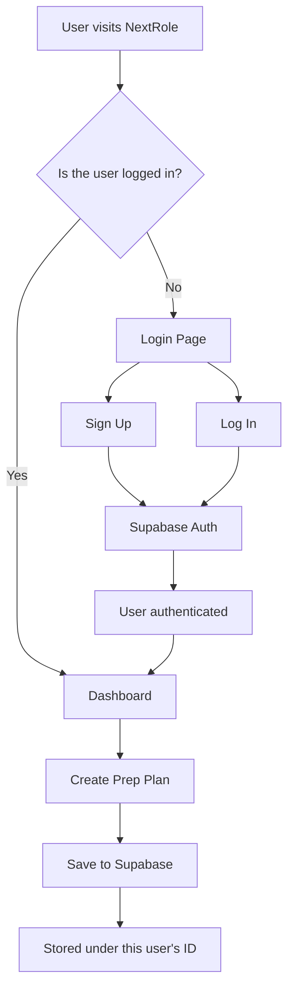

# NextRole

NextRole is a React + Vite frontend for interview preparation and career tracking. The current target flow is:

- user visits the app
- user signs in or signs up
- authenticated user reaches the dashboard
- user creates a prep plan
- the plan is saved to Supabase under that user’s ID

## Architecture flow



## Current target auth and data ownership model

- Sign in or sign up happens through Supabase Auth.
- The authenticated user is identified by `auth.uid()`.
- Prep plans are saved with `user_id = auth.uid()`.
- RLS policies restrict users to only their own prep plans.

This keeps the data model aligned with the app’s expected flow and prevents one user from reading or modifying another user’s records.

## Current Supabase schema for prep plans

The main data model for interview prep is centered on the `prep_plans` table.

```sql
create table public.prep_plans (
  id uuid primary key default gen_random_uuid(),
  plan_name text,
  target_role text,
  interview_date date,
  daily_minutes integer,
  created_at timestamptz default now(),
  user_id uuid,
  plan_data jsonb
);
```

### Meaning of the fields

- `id`: primary key for each preparation plan
- `plan_name`: human-friendly name of the plan
- `target_role`: company role or cert being targeted
- `interview_date`: target interview or exam date
- `daily_minutes`: recommended daily prep time
- `created_at`: timestamp when the plan was created
- `user_id`: authenticated user who owns this plan
- `plan_data`: structured JSONB payload for extra form details such as topics, difficulty, confidence, and notes

This keeps the core table simple while preserving the full UI form data without creating a separate table for each field.

## Quick auth integration plan

1. Create a simple auth screen for sign in and sign up.
2. Use Supabase Auth email-based sign in first.
3. Add Google OAuth as a second step when ready.
4. After login, load the authenticated user and save the prep plan with the logged-in user ID.

## Google sign-in option

Google login is possible through Supabase Auth and is a good next step for onboarding.

Typical setup:

- enable Google provider in Supabase
- add the OAuth redirect URLs in Supabase project settings
- configure the client environment variables
- use `supabase.auth.signInWithOAuth({ provider: 'google' })`

This is optional for the first pass, but it is a good fit for the product flow.

## Notes

- The frontend is intentionally kept simple and minimal.
- The prep plan save flow is expected to be tied to the logged-in user.
- Local test bypasses should be removed before production deployment.
